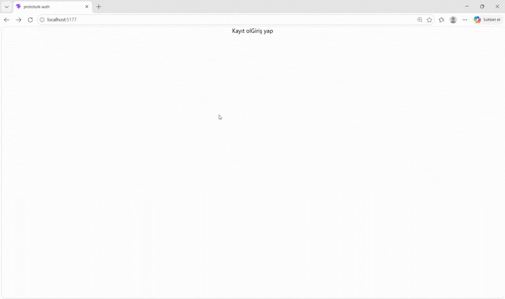

# 🔐 Prototurk-Auth

**Prototurk-Auth** is a modern authentication web application built with React, Redux Toolkit, and Firebase Authentication. It provides a secure and user-friendly experience for managing user accounts, including registration, login, email verification, and profile management.

## 🚀 Features

- 🔐 User registration and login with email and password
- 📧 Email verification
- 👤 Profile management (display name and profile photo)
- 🔄 Centralized authentication state management
- 🔑 Password management
- 🚪 User logout and session management
- 🔔 Toast notifications for success and error messages
- 📱 Responsive and user-friendly interface

## 🛠️ Tech Stack

- React
- JavaScript (ES6+)
- Firebase Authentication
- Redux Toolkit
- React Redux
- React Router DOM
- Tailwind CSS v4
- React Hot Toast
- Vite

## 📦 Project Overview

This project was developed to practice modern authentication workflows and improve frontend development skills using React and Firebase.

It demonstrates Firebase Authentication integration, centralized state management with Redux Toolkit, client-side routing, and responsive UI development.

## 🖥️ Preview

